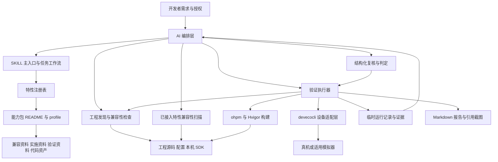
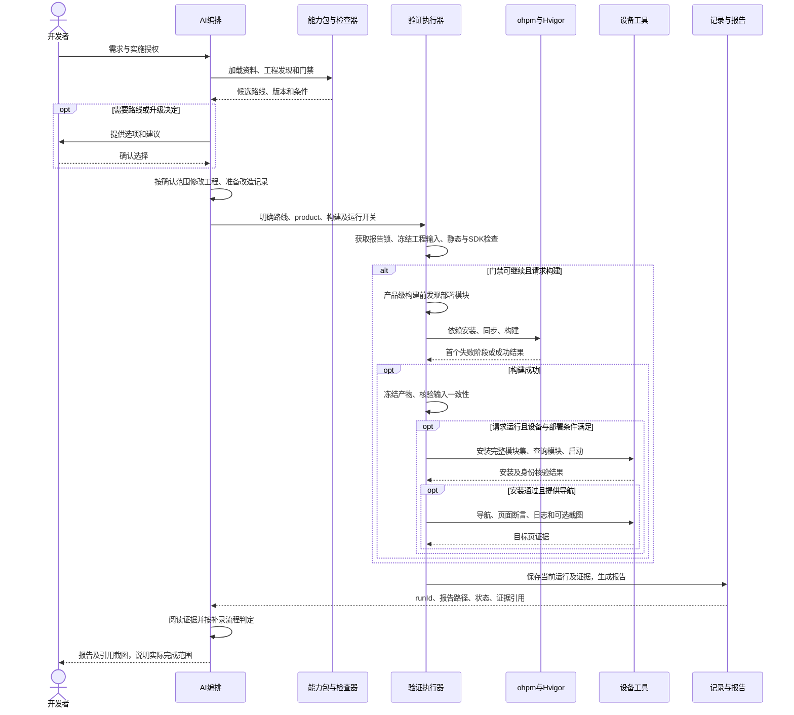
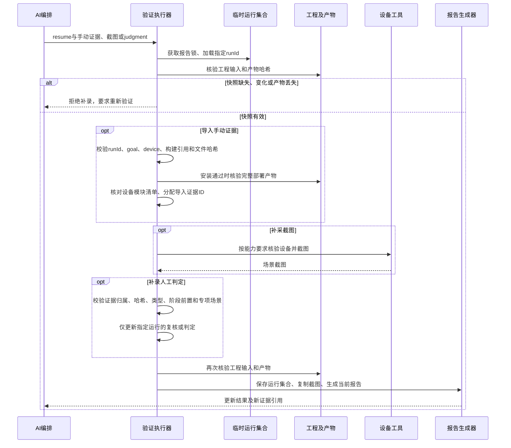

# HarmonyOS 新特性接入 Skill 软件设计说明书

| 项目 | 内容 |
|---|---|
| 系统 | `harmonyos-feature-integration` |
| 文档类型 | 软件设计说明书（Software Design Description，SDD） |
| 读者 | Skill 研发、维护、测试及能力包扩展人员 |
| 设计基线 | 当前仓库的主入口、机器契约、执行脚本、能力资产和测试 |
| 编写日期 | 2026-11-03 |

## 1. 概述与设计边界

### 1.1 系统目标

本系统辅助开发者将已注册的 HarmonyOS OS 新特性接入现有 Stage 工程，覆盖需求识别、路线选择、兼容性判断、工程实施、验证及排障。系统通过 AI 编排文档与工具，通过 Node.js 脚本检查工程、调用构建和设备工具、保存证据并生成报告。

系统包含三类不同职责：AI 理解需求、修改工程并判读证据；能力包提供特性事实、接入约束和可复用资产；脚本执行确定性检查与外部工具调用。脚本本身不接收自然语言完成需求理解，也不自动修复业务代码。

主要设计依据为 [Skill 主入口](harmonyos-feature-integration/SKILL.md)、[注册表](harmonyos-feature-integration/references/feature-registry.json)、[能力包契约](harmonyos-feature-integration/references/feature-package-contract.md)和[输出契约](harmonyos-feature-integration/references/shared/output-contracts.md)。

### 1.2 使用场景

| 场景 | 处理结果与阶段边界 |
|---|---|
| 工程发现、能否接入、方案设计 | 返回工程事实、未知项、候选路线、升级选项及验证方案；不修改工程 |
| 新特性实施 | 按已确认范围修改工程，检查、构建、部署、取证并汇总结果 |
| 已接入特性兼容性扫描 | 从源码发现已注册特性，输出需复核的调用、守卫与 SDK 声明候选 |
| 兼容性修复 | 在授权范围内修复，重新扫描并验证高低版本路径 |
| 验证已有接入 | 按实际范围验证，不反推缺失的历史基线，不自动进入改造 |
| 故障诊断 | 以现象和证据定位原因；仅在授权修复时修改工程 |
| 单独查询接口版本 | 核对相关资料及 SDK 声明，不要求无关工程 |

### 1.3 环境与依赖

| 依赖 | 用途 |
|---|---|
| Windows、macOS 或 Linux，Node.js 18+ | 运行 `.mjs` 工具脚本；工具主体使用 Node.js 内置模块 |
| 能读取本地文件、运行命令的 AI 执行环境 | 路由需求、按任务加载资料、编写代码和结构化输入、阅读证据 |
| HarmonyOS Stage 工程及本机 SDK | 工程扫描与版本门禁；SDK 根清单为 `sdk-pkg.json` |
| DevEco Studio 或 Command Line Tools，ohpm、Hvigor、JDK | 依赖安装、同步和编包；仅在构建阶段需要 |
| `devecocli`、目标设备、有效签名与平台权限 | 应用安装、查询、启动、页面操作、日志和截图；仅在相应阶段需要 |
| 特性对应的账号、授权、系统开关或外部服务 | 由能力包分别约束，不由本机 SDK 版本替代 |

### 1.4 非目标

系统不覆盖普通 ArkUI 页面开发、未注册能力的猜测性实现、窗口沉浸式及安全区适配。Agent 能力仅覆盖 Function 组件拉起，不扩展为 A2A、AgentExtensionAbility 或后端开发。平台 ACL 审批、账号登录、系统授权和真实握姿或隔空动作由开发者完成。

## 2. 总体架构

### 2.1 架构视图



### 2.2 分层职责

| 层次 | 责任 | 主要来源 |
|---|---|---|
| 编排层 | 理解任务、确定授权边界、确认路线或升级、修改工程、复核候选、阅读证据 | [主入口](harmonyos-feature-integration/SKILL.md)、[任务读取规则](harmonyos-feature-integration/references/shared/document-loading.md) |
| 知识与契约层 | 注册能力、声明路线和门槛、组织渐进加载资料、提供代码资产 | [注册表](harmonyos-feature-integration/references/feature-registry.json)、各能力 `profile.json` |
| 检查层 | 工程及 SDK 发现、版本计算、特性专项扫描、兼容性审计 | [project-tools](harmonyos-feature-integration/scripts/lib/project-tools.mjs)、专项检查器 |
| 执行层 | 按开关运行构建、冻结产物、完整部署、导航和取证 | [verify-development](harmonyos-feature-integration/scripts/verify-development.mjs)及构建、部署、设备库 |
| 记录与呈现层 | 保存运行集合、证据哈希和人工结论，合并当前结果并生成报告 | [development-report](harmonyos-feature-integration/scripts/lib/development-report.mjs) |

### 2.3 文件组织与路径契约

Skill 可执行资源位于 `harmonyos-feature-integration/`：`references/workflows/` 提供任务流程，`references/shared/` 提供共享规则，`references/features/<id>/` 提供自包含能力包，`scripts/` 和 `scripts/lib/` 提供工具，`evals/` 提供评测与夹具，`assets/templates/` 提供计划和报告模板。

注册表中的 `entry`、`profile` 相对 Skill 根目录；profile 中的文档角色相对所属能力包目录；Markdown 链接相对所在文档。不同角色可复用同一正文。注册表只收录 `ready` 能力，尚未完整的能力不注册。

仓库 `docs/` 保存来源资料；运行时应从能力入口及其链接加载所需知识，不把整份来源资料库作为默认上下文。

## 3. 能力与路线设计

### 3.1 路线矩阵

当前注册 7 类能力，共 14 条路线。下表为能力包的基础门槛；使用可选接口或配置时，实际要求可能提高。所有路线均要求 Stage，版本满足后仍须核对设备、权限和系统状态。

| 能力与入口 | 路线 ID | 基础 API | 组合关系及主要约束 |
|---|---|---|---|
| [沉浸光感](harmonyos-feature-integration/references/features/immersive-light/README.md) | `hds` | 23 | 与 `arkui` 可组合；组件家族较早的 since 不能降低材质能力门槛 |
| 沉浸光感 | `arkui` | 26 | compile 与 target 均须达 26；核对应用级材质状态和组件生效域 |
| [平行视界](harmonyos-feature-integration/references/features/easygo-parallel/README.md) | `router` | 23 | 与 `navigation` 互斥；配置在 entry 模块 |
| 平行视界 | `navigation` | 23 | 与 `router` 互斥；配置页面名、Navigation 归属及系统分栏条件 |
| [智感握姿](harmonyos-feature-integration/references/features/smart-reach/README.md) | `native-component` | 23 | 三条路线可组合；当前原生组件实例门槛为 23 |
| 智感握姿 | `operating-hand` | 15 | 同一目标只能有一个位置决策者；按 API 和所选权限核验授权 |
| 智感握姿 | `holding-hand` | 20 | 按目标组件和握持信号实施，视觉仅真机 |
| [智能体框架服务](harmonyos-feature-integration/references/features/agent-framework-kit/README.md) | `function-component` | 20 | 单路线；元服务或 `ICON_ABOVE_TITLE` 提升到 21 |
| [闪控窗／球](harmonyos-feature-integration/references/features/float-view-ball/README.md) | `float-view` | 26 | 独立闪控窗；ACL、用户授权、前台及窗口条件 |
| 闪控窗／球 | `floating-ball` | 20 | 独立闪控球；可选能力分别要求 24 或 26 |
| 闪控窗／球 | `binding` | 26 | 明确窗球绑定时只选此路线，内部复用两端；不同时选择两条独立路线代替绑定 |
| [防窥保护](harmonyos-feature-integration/references/features/dlp-anti-peep/README.md) | `status-observation` | 20 | 与 `system-mask` 可组合；仅支持具备能力的 Phone 真机，不支持元服务 |
| 防窥保护 | `system-mask` | 21 | 系统蒙层；设置和再次风险提示为 API23 可选能力 |
| [隔空传送](harmonyos-feature-integration/references/features/gestures-share/README.md) | `gestures-share` | 20 | 单路线；验证发送、接收双端和实际内容，链接直达按接收目标追加配置 |

`routeComposition.mode` 表示能力内部允许的组合方式。`recommendedRoute` 是建议项，`selectedRoutes` 表示选中的路线集合；执行器一次接收一个 `--route`，组合路线由 AI 分别执行并汇总。

### 3.2 设备与平台约束

| 能力 | 验证及平台边界 |
|---|---|
| 沉浸光感 | 按组件、系统材质开关、设备能力与性能验证；不能从单页结果推定全部组件生效 |
| 平行视界 | 宽屏窗口的系统兼容分栏方案；窗口阈值、模式和用户开关必须实际验证 |
| 智感握姿 | 原生跟手、操作手和握持手效果仅接受真机；模拟器不采集、不导入、不判定目标视觉证据 |
| 智能体框架服务 | Phone/Tablet 真机、中国境内不含港澳台；需 Agent 关联、账号、网络、签名及测试发布等条件 |
| 闪控窗／球 | 球的设备和模拟器支持按版本与能力包核对；窗和绑定不推定模拟器可用；`FLOAT_VIEW`、`USE_FLOAT_BALL` 均有 ACL 要求，窗另需用户授权 |
| 防窥保护 | Phone 真机、人脸识别和系统/应用开关；`DLP_GET_HIDE_STATUS` 为受限 ACL 权限 |
| 隔空传送 | API 资料涉及 Phone、Tablet、PC/2in1，但实际型号能力仍需确认；模拟器不能验收隔空传送；元服务接收链接不证明其可作为发送端订阅事件 |

## 4. 核心流程

### 4.1 需求路由与渐进加载

AI 完整读取注册表，以 `id`、`displayName`、`aliases` 匹配请求。中文名称可以出现在长请求中，ASCII 名称忽略大小写并去除首尾空白。名称仅用于比较或排除时不据此实施；未注册特性返回注册边界，不借用相邻能力生成代码。

命中后完整读取该能力 README 和 profile，再按任务合并公共资料及候选或选中路线的正文。索引文件必须继续读取到实际内容；同文件只需读取一次。多特性请求分别保留门禁和路线决定，共享组件的改动由 AI 合并核对。

设计阶段可读取实施与资产资料以制定方案，但只交付方案。只有实施、修复或相应验证获得授权后，才进入修改和设备操作。详见[任务读取规则](harmonyos-feature-integration/references/shared/document-loading.md)。

### 4.2 工程发现与可行性

1. 扫描工程配置与源码，提取模型、模块、product 版本、组件及专项使用线索。
2. 定位并验证 SDK 根清单，确定本机 SDK API 与有效 compile API。
3. 从 profile 和专项扫描结果计算路线要求，识别升级选项、未知条件及回退需求。
4. 多条可用路线或存在升级选项时，由开发者确认；单条路线且无需升级时给出建议理由后继续。
5. 已有及计划新增字段/API 都纳入要求。扫描只能发现已实现内容，计划新增内容由 AI 在方案中补充核验。

### 4.3 新接入验证时序



静态 `fail` 或 SDK 门禁失败会阻止构建。静态 `warn` 可以继续收集构建和运行证据，但最终静态阶段仍需复核。AI 根据日志修复本次改造问题后创建新运行；`--resume` 不承担重新构建、安装或导航。

### 4.4 已接入特性的兼容性扫描与修复

[audit-compatibility](harmonyos-feature-integration/scripts/audit-compatibility.mjs)读取 product 兼容版本、已注册特性线索、导入/别名/事件字符串、守卫候选，并扫描 SDK 声明中的 `@since`、SysCap 和重载签名候选。

AI 继续确认符号所属、实际重载、调用链和回退覆盖。扫描结果不自动判定某个守卫已保护调用。只扫描时不修改工程；修复任务按各能力包的兼容性审计资料实施，并验证构建、高版本和低版本路径，不套用新接入的升级选路流程。

### 4.5 证据补录时序



单独提交 judgment 不调用设备。手动证据先导入，再使用返回的新证据 ID 补录判定；清单中的 `key` 不是最终证据 ID。直接导入开发者截图也不自动生成视觉通过。

## 5. 模块设计

### 5.1 工程、SDK 与版本检查

[project-tools](harmonyos-feature-integration/scripts/lib/project-tools.mjs)提供 `inspectProject`、`loadFeature`、`evaluateCompatibility` 和 `verifyInspection`。工程发现读取 `.ets`、`.ts`、`.json`、`.json5`，跳过版本库、构建和依赖目录，跳过大于 2 MiB 的单个文本文件；不能据此保证发现所有封装或动态用法。

SDK 定位优先显式 `--sdk`，其次为工程 `local.properties` 的 `sdk.dir`/`hwsdk.dir`，无候选时使用 `DEVECO_SDK_HOME`、`HARMONYOS_SDK_HOME`、`OHOS_SDK_HOME`。定位和版本证据不足时返回未知或无效状态，不扫描整盘猜测安装位置。

新接入路线门禁验证 SDK 根清单，具体符号可用性仍依赖源码核对和真实构建。兼容性审计另行读取声明文件，两类检查不能互相替代。模块材质状态检测对完整文本先掩码注释，再定位材质名称并读取值。

### 5.2 专项检查器

| 实现 | 责任 |
|---|---|
| [material-inventory](harmonyos-feature-integration/scripts/lib/material-inventory.mjs)与 project-tools | HDS/ArkUI 入口信号、组件候选、应用级材质和属性冲突检查 |
| [easygo-tools](harmonyos-feature-integration/scripts/lib/easygo-tools.mjs) | JSON5 清单子集解析、entry 配置引用、互斥路线、字段及页面检查、有效 API 计算 |
| [smart-reach-tools](harmonyos-feature-integration/scripts/lib/smart-reach-tools.mjs) | 握姿路线、事件、权限、目标归属与订阅清理线索 |
| [agent-framework-tools](harmonyos-feature-integration/scripts/lib/agent-framework-tools.mjs) | Function 参数、应用类型、事件、版本和外部条件检查 |
| [window-privacy-tools](harmonyos-feature-integration/scripts/lib/window-privacy-tools.mjs) | 窗、球、绑定及防窥用法、权限、版本和生命周期线索 |
| [gestures-share-tools](harmonyos-feature-integration/scripts/lib/gestures-share-tools.mjs) | 事件订阅、文件/链接载荷和接收相关检查 |
| [compatibility-audit](harmonyos-feature-integration/scripts/lib/compatibility-audit.mjs) | 已接入特性的调用、守卫及 SDK 声明候选，人工复核报告呈现 |

专项代码通过通用检查入口分派。profile 提供机器可读约束，但新增能力不是仅添加 JSON 即可执行：还需要相应的扫描、兼容性计算、静态检查及回归覆盖。

### 5.3 验证执行器与构建

[verify-development](harmonyos-feature-integration/scripts/verify-development.mjs)负责新运行和补录两条路径。`verifyDevelopment(request, options)` 返回 `{runId, report, status, evidence}`；`options` 可注入 inspector、构建、设备及部署实现用于测试，命令行不暴露这些注入点。

[hvigor-build](harmonyos-feature-integration/scripts/lib/hvigor-build.mjs)解析 Studio/CLT 工具路径、Node、ohpm、Hvigor 和 JDK，按顺序执行 `ohpm install --all`、Hvigor `--sync`、打包；Hvigor 带 `--no-daemon`。产品级任务为 `assembleApp`；只构建指定模块时按类型选择 `assembleHap`、`assembleHsp` 或 `assembleHar`，模块 target 使用 `@default`。

请求运行时始终进行产品级构建，`--module` 只选择启动模块。外部进程采用参数数组和 `shell:false`，Windows 隐藏窗口；默认单阶段超时 600000 ms，超时发出进程终止请求，记录日志并停止后续构建阶段。

### 5.4 完整部署

[development-deployment](harmonyos-feature-integration/scripts/lib/development-deployment.mjs)提供四个关键步骤：

1. `discoverDeployment` 在构建前按 product 的 `targets/applyToProducts` 发现本地 entry、feature、shared 模块；HAR 不独立部署。确定 bundle、versionCode、启动模块和 Ability。
2. `planDeployment` 在构建后从各 target 的 `output_metadata.json` 定位唯一 HAP/HSP，选择适用签名产物并计算哈希，核对构建前后模块范围。
3. `deployProduct` 核验快照后一次安装完整模块集，通过设备应用信息核对身份、版本、缺失和额外模块，再启动 Ability。
4. `verifyInstalledModules` 校验设备返回的模块集合和可用模块版本信息；手动安装补录复用同一逻辑。

无法唯一确定 target、缺包、模块重名、外部 HSP 无法核实、签名不足或设备残留其他产品模块时阻断部署。设备身份及模块版本核对不等同于读取设备安装包并进行字节级哈希比对；安装后证据仍需结合本轮部署日志。

### 5.5 设备导航与证据采集

[development-device](harmonyos-feature-integration/scripts/lib/development-device.mjs)封装 `devecocli` 调用与导航。Windows 从 `devecocli.cmd` 定位包内 Node 入口后运行；其他平台直接执行 CLI。命令参数拒绝空字符和换行。

导航读取组件树，以 `id`、`text` 或 `type` 精确匹配；点击目标必须唯一且存在有效 bounds，按中心坐标点击。最后一步必须断言业务页面内容，不能只命中 Navigation 等容器。固定等待只承担等待，不能代替断言。

[deveco-json](harmonyos-feature-integration/scripts/lib/deveco-json.mjs)仅允许剥离已识别的外层工具提示，再解析唯一完整 JSON，并核对设备、组件树或应用模块结构。截图按 PNG/JPEG 文件头识别并确定扩展名；该检查不承担完整图片解码、真实性或视觉内容判断。

### 5.6 运行集合与证据存储

[development-report](harmonyos-feature-integration/scripts/lib/development-report.mjs)按输出目录绝对路径的 SHA-256 定位临时记录：

```text
<系统临时目录>/harmonyos-os-feature-verification/<输出路径哈希>/
  collection.json        当前运行集合
  lock/                  同报告互斥锁
  <runId>/               原始静态、构建、设备和导入证据

<output>/
  integration-report.md
  evidence/<图片内容哈希>.png 或 .jpg
```

运行集合属于单一工程。若临时集合丢失而最终报告已存在，系统拒绝安全合并，要求新的输出目录。同一改造项的新运行替换当前集合中的旧运行，并保留可确认的改造前版本；旧 runId 此后不能补录。

同目标匹配先比较 feature、route、product、buildMode 和归一化 module；双方都有稳定 `changes.id` 且相同时匹配。ID 不同但 goal、页面/组件/类别/效果、去重后的文件集合全部一致时，也视为同项。未同时提供 ID 时以页面和组件匹配。不同路线和不同 product 分别记录。

### 5.7 报告生成

报告按改造汇总、类别或路线、视觉验证、升级与兼容四部分输出。阶段结果来自运行记录；图片按内容哈希复制并使用宽度 270px 的 HTML img 嵌入。旧报告引用而新报告不再使用的图片，仅在名称和内容哈希一致时清理。

报告生成先复制正文，再通过临时文件重命名保存集合；两者不构成跨文件事务。当前版本对照表取运行集合首项的 `before/after`，不能从该表推定后续改造或其他 product 的全部版本变化。跨上下文结论需要结合各运行记录核对。

## 6. 接口与数据契约

### 6.1 CLI 接口

以下脚本路径相对 Skill 根目录。`<...>` 为需要替换的参数值。

| 脚本 | 必需输入 | 可选输入 | 输出 |
|---|---|---|---|
| `scripts/inspect-project.mjs` | `--project` | `--sdk`、`--product` | 工程、SDK、版本、模块、信号和未知项 JSON |
| `scripts/check-compatibility.mjs` | `--project`、`--feature` | `--sdk`、`--product` | 可行性状态、路线、升级和回退要求 JSON |
| `scripts/verify-integration.mjs` | `--project`、`--feature` | `--route`（默认 auto）、`--sdk`、`--product` | 静态 checks、counts、状态 JSON |
| `scripts/verify-development.mjs` | 新运行：`--project --feature --route --goal --changes`；补录：`--project --resume` 及至少一种补录操作 | 见下表 | 运行摘要 JSON，以及报告和截图 |
| `scripts/audit-compatibility.mjs` | `--project` | `--feature`、`--sdk`、`--product`、`--format json/markdown`、`--review` | 扫描 JSON 或复核后的 Markdown；review 仅配合 markdown |
| `scripts/validate-structure.mjs` | 无 | 一个位置参数：Skill 根目录 | 结构及链接校验 JSON |
| `scripts/validate-feature-package.mjs` | `--feature` | 无 | 已注册能力的契约校验 JSON |

验证执行器的可选参数如下：

| 分组 | 参数及语义 |
|---|---|
| 工程与构建选择 | `--sdk`、`--product`（default）、`--build-mode`（debug）、`--module`、`--ability` |
| 执行动作 | `--execute-build`、`--execute-run`；运行要求本轮成功构建，单独 execute-run 不隐式构建 |
| 设备与页面 | `--device`、`--bundle`（日志过滤）、`--navigate <JSON>` |
| 采集 | `--capture-layout`、`--capture-screenshot`、`--screenshot-scenario` |
| 导入 | 可重复的 `--import-screenshot`、`--screenshot-purpose target/fallback`（默认 target）、`--manual-evidence <JSON>` |
| 判定和输出 | `--judgment <JSON>`、`--output`（默认工程下 os-feature-integration）、`--resume <runId>` |

resume 禁止 execute-build、execute-run、navigate、capture-layout 和 changes。截图场景名为 1–80 字单行文本；补采要求显式场景名、本轮安装及导航通过，指定设备须与原运行一致。用户输入 JSON 使用 UTF-8，允许文件开头 BOM；读取或解析错误包含文件绝对路径。

示例：在 Skill 根目录执行，只检查并建立一次运行，不隐式调用构建或设备：

```text
node scripts/verify-development.mjs --project <工程绝对路径> --feature easygo-parallel --route router --goal 平行视界主页 --changes <changes.json绝对路径> --sdk <SDK绝对路径> --product default --output <报告目录绝对路径>
```

执行器正常返回的摘要形状如下。`evidence` 可包含静态记录、日志、部署清单和截图；实际列表及哈希由本轮执行产生：

```json
{
  "runId": "<本轮UUID>",
  "report": "<报告绝对路径>/integration-report.md",
  "status": "inconclusive",
  "evidence": [
    { "id": "E1", "type": "static", "path": "<本轮证据绝对路径>/E1.json", "sha256": "<文件SHA-256>" }
  ]
}
```

### 6.2 注册表与能力 profile

| 数据 | 核心字段与约束 |
|---|---|
| 注册表 | `registryVersion: "1.0"`、`features[]`；注册项字段为 id、displayName、aliases、status、entry、profile |
| 路由键 | id 唯一且为小写 kebab-case；展示名和别名不能与其他能力冲突 |
| profile 身份 | `schemaVersion: "1.0"`、`featureId` 与注册 ID 对应 |
| 路线 | `routes[].id/minApi`，按需声明 minTargetApi、requiresStage、moduleTypes 及路线文档映射 |
| 组合 | `routeComposition.mode` 为 composable/exclusive；selectionField 为 selectedRoutes；allowed 声明路线 ID |
| 可选能力 | `capabilities` 提供独立 minApi，由专项逻辑计算实际 requiredApi |
| 回退 | `fallbackPolicy.baseline` 为 pre-integration-source-state；appliesWhen 和 preserve 描述条件及保留维度 |
| 资料角色 | `documents` 与路线 documents 连接兼容、实施、资产、回退、验证和排障正文 |

一个实际注册项的最小完整形状如下；可注册能力仍须具备对应的完整 profile 与正文：

```json
{
  "id": "easygo-parallel",
  "displayName": "平行视界",
  "aliases": ["easyGo", "easy_go.json", "平行视界接入"],
  "status": "ready",
  "entry": "references/features/easygo-parallel/README.md",
  "profile": "references/features/easygo-parallel/profile.json"
}
```

字段的实际结构以[能力包契约](harmonyos-feature-integration/references/feature-package-contract.md)、[平行视界 profile](harmonyos-feature-integration/references/features/easygo-parallel/profile.json)等已注册 profile 和校验器共同为准，不将各能力的专项字段视为完全相同的通用 schema。

以下为平行视界 profile 的字段投影，说明身份、组合和单条路线的关系；省略了另一条路线、公共文档及回退等字段，不能直接作为完整能力包注册：

```json
{
  "schemaVersion": "1.0",
  "featureId": "easygo-parallel",
  "routeComposition": {
    "mode": "exclusive",
    "selectionField": "selectedRoutes",
    "allowed": ["router", "navigation"]
  },
  "routes": [
    {
      "id": "router",
      "minApi": 23,
      "requiresStage": true,
      "moduleTypes": ["entry"],
      "documents": {
        "implementation": "routes/router/implementation.md",
        "validation": "routes/router/implementation.md",
        "assets": "routes/router/implementation.md"
      }
    }
  ]
}
```

### 6.3 检查结果与运行记录

| 对象 | 关键字段 |
|---|---|
| inspection | schemaVersion、projectRoot、product、model、api、localSdk、modules、signals、各专项结果、evidence、unknown、scan |
| compatibility | featureId、status、availableRoutes、recommendedRoute、selectedRoutes、decisionRequired、upgradeOptions、fallbackRequirements，以及专项 SDK/路线要求 |
| 静态检查 | checks 中包含 id、label、status、evidence、message；counts 按 pass/warn/fail/not_applicable 汇总 |
| collection | project 及 runs[]；同一输出目录只属于一个工程 |
| run | runId、project、feature、featureName、goal、route、product、buildMode、module、ability、changes、createdAt、device、checks、evidence、after、inputHash |
| 构建/部署扩展 | buildScope、expectedDeployment、deployment、deploymentEvidence、deploymentVerified、artifacts，按阶段产生 |
| 人工与专项扩展 | staticFindings[].review、manualVerification、requiredRuntimeScenarios、运行 observations 等 |
| evidence | id、type、path、sha256；按来源增加 origin、purpose、scenario |

新运行以 UUID 标识，证据在该运行内分配 `E1` 等 ID。引用必须由 `id + sha256` 指向本轮现存文件。哈希是内容一致性校验，不是来源签名或真实性证明。

运行记录的阶段及版本投影如下，其余标识、改造记录和证据字段见上表；本例表示静态与 SDK 检查完成，尚未执行构建和实测：

```json
{
  "feature": "easygo-parallel",
  "route": "router",
  "product": "default",
  "buildMode": "debug",
  "after": { "sdk": 23, "compile": 23, "target": 23, "compatible": 23 },
  "checks": {
    "static": { "status": "passed", "summary": "静态检查通过" },
    "sdk": { "status": "passed", "summary": "本机 SDK API 23，router 路线可用" },
    "build": { "status": "not_run", "summary": "未请求构建" },
    "install": { "status": "not_run", "summary": "未请求安装运行" },
    "navigation": { "status": "not_run", "summary": "应用未成功安装启动" },
    "runtime": { "status": "not_run", "summary": "未完成目标页验证" },
    "visual": { "status": "not_run", "summary": "未完成目标页视觉验证" },
    "fallback": { "status": "not_applicable", "summary": "最低兼容 API 不低于本次能力门槛，无低版本回退分支" }
  }
}
```

### 6.4 改造记录

`changes` 是 AI 提交的实际改动描述，不由扫描器自动重建。版本未知填 `"unknown"`；三个回退条件必须记录行为和状态。以下为可用于建立运行的最小示例，文件和版本需按工程填写：

```json
{
  "schemaVersion": "1.0",
  "id": "home-easygo",
  "page": "首页",
  "component": "Router",
  "category": "系统分栏",
  "effect": "主页已配置 Router 平行视界，实际效果待验证",
  "files": ["entry/src/main/module.json5"],
  "before": { "sdk": 23, "compile": 23, "target": 23, "compatible": 23 },
  "fallback": [
    { "condition": "low-api", "behavior": "保留原导航", "status": "not_run" },
    { "condition": "unsupported", "behavior": "保留原单页布局与交互", "status": "not_run" },
    { "condition": "disabled", "behavior": "保留原单页布局与交互", "status": "not_run" }
  ]
}
```

回退状态可为 passed、failed、not_run、not_applicable；除 not_run 外需提供非空 evidence 说明。`effect` 描述已实施配置，不能代替验证结论。

### 6.5 导航描述

```json
{
  "schemaVersion": "1.0",
  "steps": [
    {
      "stepId": "open-detail",
      "action": "tap",
      "locator": { "by": "id", "value": "detail-entry" },
      "expectPage": { "by": "id", "value": "detail-content" }
    }
  ]
}
```

stepId 唯一，仅包含字母、数字、下划线及连字符。动作包括 launch、tap、swipe、input、wait。swipe 使用方向或两个二维坐标；input 提供非空 value 和可选定位；wait.timeoutMs 为 1–30000 的整数。最后一步必须提供 expectPage。

### 6.6 人工判定

judgment 必须绑定当前 runId 和完全一致的 goal，至少包含 visual、runtime、fallback、staticReview 之一。以下为仅进行静态复核的最小结构；占位字段必须替换为指定运行真实的 warn 项和代码依据：

```json
{
  "schemaVersion": "1.0",
  "runId": "<本轮runId>",
  "goal": "平行视界主页",
  "staticReview": {
    "results": [
      { "id": "<本轮warn检查项ID>", "status": "passed", "note": "<沿实际调用链核对后的代码依据>" }
    ]
  }
}
```

| 分支 | 约束 |
|---|---|
| staticReview | 非空 results；id 属于本运行 warn，不重复；status 为 passed/failed；note 必填；不覆盖 fail，也不跨运行继承 |
| visual | status 为 passed/failed/inconclusive；summary 和 evidence 必填，至少引用截图，不能引用 fallback 用途截图 |
| runtime | 同样的状态和说明要求，至少引用 runtime_log/component_tree；可提供逐场景 observations，并引用 runtime.evidence 内的证据 |
| fallback | condition 为 low-api/unsupported/disabled；passed 至少引用 purpose=fallback 的截图；不接受 purpose=target 的截图；成功或失败同步对应 changes.fallback |

效果判定要求构建通过；常规运行判定还要求安装和导航通过。全为手动来源且仅 inconclusive 的有限运行观察、全为开发者或手动来源的视觉判定存在明确的前置例外，仍不能将未通过的安装/导航阶段改成通过。专项通过规则见第 8 节。

### 6.7 手动证据清单

以下清单仅导入目标截图，不声明安装或导航通过。示例中的路径、哈希和引用必须来自本轮真实证据：

```json
{
  "schemaVersion": "1.0",
  "runId": "<本轮runId>",
  "goal": "平行视界主页",
  "device": "<本轮设备ID>",
  "buildEvidence": { "id": "<本轮build_log证据ID>", "sha256": "<该日志SHA-256>" },
  "provenance": "<采集设备、本轮产物及操作过程的关联依据>",
  "files": [
    { "key": "target", "type": "screenshot", "path": "<截图绝对路径>", "sha256": "<截图SHA-256>" }
  ]
}
```

files 非空且 key 唯一；支持 screenshot、component_tree、runtime_log、install_log、navigation_log、device_info、installed_modules。可选 deviceInfo 指向设备信息文件 key，序列号须匹配原设备，不能覆盖明确模拟器事实。

可选 stages 只支持 install/navigation，状态为 passed/failed/inconclusive，每项均需 summary 和文件 key 引用。安装通过还必须引用本轮 deploymentEvidence，提供 installedModules key，并引用同次安装日志及设备应用信息。执行器验证本轮完整产物与设备模块集合。导航通过要求安装核验通过，且有页面断言日志或组件树。构建通过但没有完整产品部署快照的模块级运行，不能补录安装通过。

### 6.8 兼容性审计复核输入

audit 的 review 可含 mode、findings、verification、pending。findings 使用已发现的 candidateId，status 为 protected、missing-protection、not-required、needs-review，并提供 evidence；protected 还需 sdkEvidence。verification 的 build/high/low 分别记录状态及证据。

该接口校验引用和部分结构，不自动理解所提交证据。三个验证项为 `status: "pass"` 且有证据时，报告只声明所提交证据齐全，仍需人工核对版本矩阵和场景覆盖。

## 7. 状态与异常处理

### 7.1 状态域

| 状态域 | 枚举及语义 |
|---|---|
| 兼容性 | supported：已发现的必要工程条件满足；conditional：基础可用但有额外条件；upgrade_available：可通过升级满足；unsupported：已知事实排除；insufficient_context：关键上下文不足 |
| 静态单项 | pass、warn、fail、not_applicable；warn 是待复核线索，不直接等于确认缺陷 |
| 静态结果 | passed、warnings、failed |
| 验证阶段 | passed、failed、not_run、inconclusive、not_applicable |
| 整体运行结果 | passed、failed、inconclusive |
| changes.fallback | passed、failed、not_run、not_applicable；与 judgment 的状态域不同 |

验证阶段固定包括 static、sdk、build、install、navigation、runtime、visual、fallback。初始为 not_run；目标页导航通过后 runtime 进入 inconclusive；截图采集或导入后 visual 进入 inconclusive，待 AI 阅读并判定。

整体聚合由 `deriveVerdict` 执行：任一 checks 或 changes.fallback 为 failed，则整体 failed；所有检查及回退项均为 passed/not_applicable 才是 passed；其余均为 inconclusive。低版本回退阶段是否适用，根据 compatible 与本次能力门槛比较；设备不支持和特性关闭等回退记录仍独立参与整体判定。

### 7.2 失败位置与恢复

| 条件 | 系统行为与恢复条件 |
|---|---|
| 结构、资料映射或关键版本缺失 | 编排层停止依赖该资料的步骤，补齐事实后再判断 |
| SDK 或静态 fail | 不构建；修复或完成已确认的升级后创建新运行 |
| 静态 warn | 保留未确认，可继续取证；按本运行复核，不能用视觉通过替代 |
| 构建失败或超时 | 保存阶段和日志，不安装；由 AI 修复本次问题并重新构建 |
| 产物范围、签名、模块完整性不符 | 停止安装或启动；不拿其他 product 的旧包补齐，不自动卸载或清除数据 |
| 设备信息、页面定位或断言失败 | 不判定目标效果；检查原始命令输出及目标内容 |
| 工程输入在新运行中变化 | 阻止继续部署或将当前运行标为失败，保留可生成的失败报告 |
| resume 快照缺失、变化或产物丢失 | 拒绝补录，重新验证；无法在旧运行上重建 |
| 引用不属于本轮、哈希不符、证据丢失 | 拒绝该判定或导入，使用真实本轮证据重新提交 |
| 报告锁或构建锁已存在 | 拒绝并发执行；不自动回收其他运行的锁 |
| 临时集合丢失、但输出报告存在 | 不推测恢复记录，要求新的输出目录 |

锁通过目录创建实现，正常退出在 finally 中释放。进程异常退出后的锁没有自动过期回收逻辑。部分输入错误、文件错误直接以执行器错误退出，不能保证每种错误都产生新的报告。

### 7.3 退出码

| CLI | 0 | 1 | 2 |
|---|---|---|---|
| inspect-project/check-compatibility/audit-compatibility | 正常输出；兼容性状态可能仍不可接入 | 未用作业务判定 | 输入或执行错误 |
| verify-integration | 无静态 fail，可能存在 warn | 有静态 fail | 输入或执行错误 |
| verify-development | 整体 passed 或 inconclusive | 整体 failed | 输入或执行器错误 |
| 结构及能力包校验 | valid | invalid | 执行异常 |

调用方必须同时读取 JSON 状态与具体阶段，不能以退出码 0 推断功能已通过。

## 8. 可靠性与兼容设计

### 8.1 Product 与版本语义

工程检查只从根 `build-profile.json5` 解析所选 product：同名字段优先取 product 自有值，其次取 app 级值。未指定时选择 default；没有 default 但只有一个 product 时选择唯一项；多项且无 default 则要求显式选择。显式不存在或重名 product 报错。

验证执行器的 product 默认明确为 default，不自动选唯一的非 default 产品。显式 compile 无法解析时保持 unknown；只有字段确实未配置且 SDK 有效时，compile 才回落到 SDK API，标为 local-sdk-default。target 和 compatible 不用本机 SDK 代填。

所选路线和实际所用可选接口决定 requiredApi；SDK 与有效 compile 至少达到 requiredApi，target 按统一接入策略至少达到 requiredApi 与 minTargetApi 的最大值。该策略不表示所有 API 都有额外官方 target 硬门槛。升级保留 compatible 和已有更高版本，写入配置前仍需确认目标构建工具接受的版本类型与格式。

工程扫描的源文件和组件信号仍是工程范围，并未完全按 product 排除全部条件编译或依赖分支。审计可输出多个 product，但共享 SDK 声明扫描和工程发现上下文；单个 SDK 发现结果不能证明每个产品的活动编译 SDK。

### 8.2 源程序回退

所有能力包以 `pre-integration-source-state` 为回退基线。低版本、设备不支持、用户未授权、系统关闭或外部条件不足时，保留适用的原组件树、布局、数据、导航、事件和异常行为。源码基线由 AI 在实施前记录；脚本不自动还原或证明完整的原业务语义。

专项规则优先。例如沉浸光感导航迁移低版本分支保留原树；达到路线门槛后，材质不可用或关闭时按专项规则退回材质，不因此自动换回原导航结构。回退实测与目标效果使用不同用途截图，不能互相支撑通过。

### 8.3 输入与产物一致性

[verification-inputs](harmonyos-feature-integration/scripts/lib/verification-inputs.mjs)对模块目录、src/AppScope/hvigor 下的输入、指定源码/配置扩展名及根构建配置计算文件内容哈希，再按相对路径排序汇总为 inputHash。构建、依赖、版本库目录及独立报告输出被排除；输出目录不能覆盖模块或源码目录；输入符号链接会阻断冻结。

产品构建冻结选定 HAP/HSP 的路径和哈希；模块构建冻结输出目录中的 HAP/HSP/HAR。新运行在检查前保存输入指纹，并在部署前及最终保存前核验；resume 在处理前后核验。新增、删除或修改覆盖范围内的输入，以及冻结产物变化或丢失，都会使原运行不能继续正常补录。

该快照不是全环境镜像：不包含整个 SDK、操作系统、所有依赖安装目录或设备状态，也不覆盖任意自定义构建脚本读取的所有外部文件。它与构建证据、部署清单和人工来源核对共同使用。

### 8.4 人工复核与证据真实性

静态复核绑定单一 runId 和检查项 ID，新运行不继承旧结论。已确认 fail 必须修复后重验。判断依据的语义、截图来源及操作真实性由 AI 结合开发者操作和原始资料复核；SHA-256 只证明被引用文件未变。

报告生成不会自动脱敏全部日志或截图，也没有持久化证据的加密、远程签名或自动保留期机制。按[隐私与安全规则](harmonyos-feature-integration/references/shared/privacy-and-security.md)，执行者仅采集必要内容，不收集无关密钥、证书和账号数据。

### 8.5 专项运行验收

| 能力 | 可由执行器约束的证据要求 |
|---|---|
| 智感握姿 | 目标视觉要求已确认真机；补采前重新查询身份，由开发者完成握姿动作 |
| 智能体框架服务 | Phone/Tablet 真机；视觉通过至少两张不同截图；运行通过覆盖 entry-clicked、dialog-opened、dialog-closed，并引用日志或组件树 |
| 闪控窗／球 | 视觉通过至少两张不同截图；运行覆盖启动、更新、停止、回退和设备支持；绑定追加双向切换及 pair-stopped |
| 防窥保护 | Phone 真机；视觉前后状态截图；运行覆盖开关、HIDE/PASS、回退、退订；按使用接口追加设置、提示、蒙层和窗口失效场景 |
| 隔空传送 | 支持形态的真机；视觉至少两张不同截图，由 AI 确认发送/接收来源；运行覆盖 sender-grab、receiver-content、background-cleanup |

设备类型识别依赖设备查询字段，未知不当作已确认真机。窗与绑定的支持限制、ACL 审批、人脸开关、双端信任等平台事实仍需按能力包核验，不能仅凭截图数量、SysCap 或观察文案确认。

### 8.6 资产生命周期

Agent 示例在页面显示和消失时更新可见标志及请求序号。查询成功和失败写回前同时检查可见性、请求序号、controller 和 agentId，防止旧 Promise 覆盖新状态；事件退订使用同一实例回调。

窗球资产以系统状态回调确认停止，停止请求完成不等于已到 STOPPED；绑定释放需满足双端终态约束。闪控窗 `getWindowProperties()` 在未就绪、STOPPED 或 ERROR 时抛错；页面布局使用 `getFloatViewProperties()` 安全包装并判空，在有效状态后刷新避让区。相关实现见[Agent 资产](harmonyos-feature-integration/references/features/agent-framework-kit/assets/Agent.ets)和[闪控窗资产](harmonyos-feature-integration/references/features/float-view-ball/assets/FloatViewController.ets)。

## 9. 测试与扩展维护

### 9.1 测试分层与覆盖

当前 `evals/` 包含 22 组 `run-*-tests.mjs`。以下对应关系说明测试责任，不表示真实设备或平台服务已通过验收。

| 测试类别 | 测试脚本 | 覆盖重点 |
|---|---|---|
| 基础及输入 | run-tool-tests、run-smoke-tests、run-manifest-parser-tests、run-input-boundary-tests | 工程与 SDK、路由门禁、清单子集、注释材质、BOM 和带路径的错误 |
| 版本及兼容审计 | run-target-upgrade-tests、run-compatibility-audit-tests | 升级策略、逐产品上下文、SDK 声明及守卫候选 |
| 能力专项 | run-easygo-tests、run-smart-reach-tests、run-agent-framework-tests、run-gestures-share-tests、run-window-privacy-tests | 各能力规则、权限、参数、路线及证据约束 |
| 验证闭环 | run-development-tests、run-executor-regression-tests、run-deployment-tests、run-manual-verification-tests、run-verification-context-tests | 阶段状态、完整 HAP/HSP 集、手动导入、复核隔离、输入及产物失效 |
| 资产行为 | run-agent-lifecycle-tests、run-anti-peep-utils-tests、run-float-view-controller-tests、run-floating-ball-controller-tests、run-float-view-ball-controller-tests | 迟到 Promise、异常返回、控制器和绑定生命周期 |
| 文档关系 | run-document-links-tests | 本地链接、锚点、入口可达性和循环索引边界 |

fixtures 提供不同 API 的 SDK 根清单和工程状态，验证规则的输入输出。部分 ArkTS 资产测试将平台导入替换为 mock，并进行类型转换后执行；这不承担真实 ArkTS 编译器、SDK 类型系统或设备服务验证。`evals.json` 记录行为评测场景，不等同于单独运行 Node 回归脚本已完成所有 AI 行为评测。

### 9.2 验证方式

在 Skill 根目录分别执行：

```text
node scripts/validate-structure.mjs
node scripts/validate-feature-package.mjs --feature <已注册特性ID>
node evals/run-input-boundary-tests.mjs
node evals/run-agent-lifecycle-tests.mjs
node evals/run-verification-context-tests.mjs
```

全量回归运行 `evals/run-*-tests.mjs` 中的每个脚本，并逐项检查退出状态。资产测试使用的 Node 类型转换选项需要支持该选项的 Node 版本；Skill 工具运行的 Node.js 18+ 下限不代表所有资产测试都可在该版本运行。

真实接入验收还需目标 SDK 编译、签名/权限核验、完整部署、目标页面、目标效果及适用回退环境验证。mock 通过、源码匹配或截图命令成功均不能代替这些结果。

### 9.3 新能力包扩展

1. 在注册表之外准备能力目录、稳定 ID 和完整 profile；提供定位、来源版本、兼容、前置条件、实施、回退、验证及排障八类内容。
2. 建立 README 到公共资料、路线正文和实际代码资产的任务读取链；定义组合或互斥关系、可选能力门槛和源程序回退规则。
3. 在通用检查分派及专项库中补充必要逻辑；若有运行验收约束，同时接入设备、场景与判定检查。不能假定未知 profile 字段会自动执行。
4. 增加正常、版本不足、未知环境、回退、生命周期、误路由与证据失效场景的工程/SDK 夹具及测试。
5. 完成资料后以 ready 加入注册表，在发布前运行结构校验、能力包校验、相关回归与行为评测。新增能力不修改其他能力的既有业务边界。

### 9.4 维护责任

能力包维护者负责事实来源、版本及限制；执行器维护者负责契约解析、阶段状态、外部工具适配和记录一致性；测试维护者负责规则及异常场景覆盖。CLI、字段、路线或验收约束变化时，同步检查入口、profile、工作流、资产、测试和本说明书中的对应描述。
